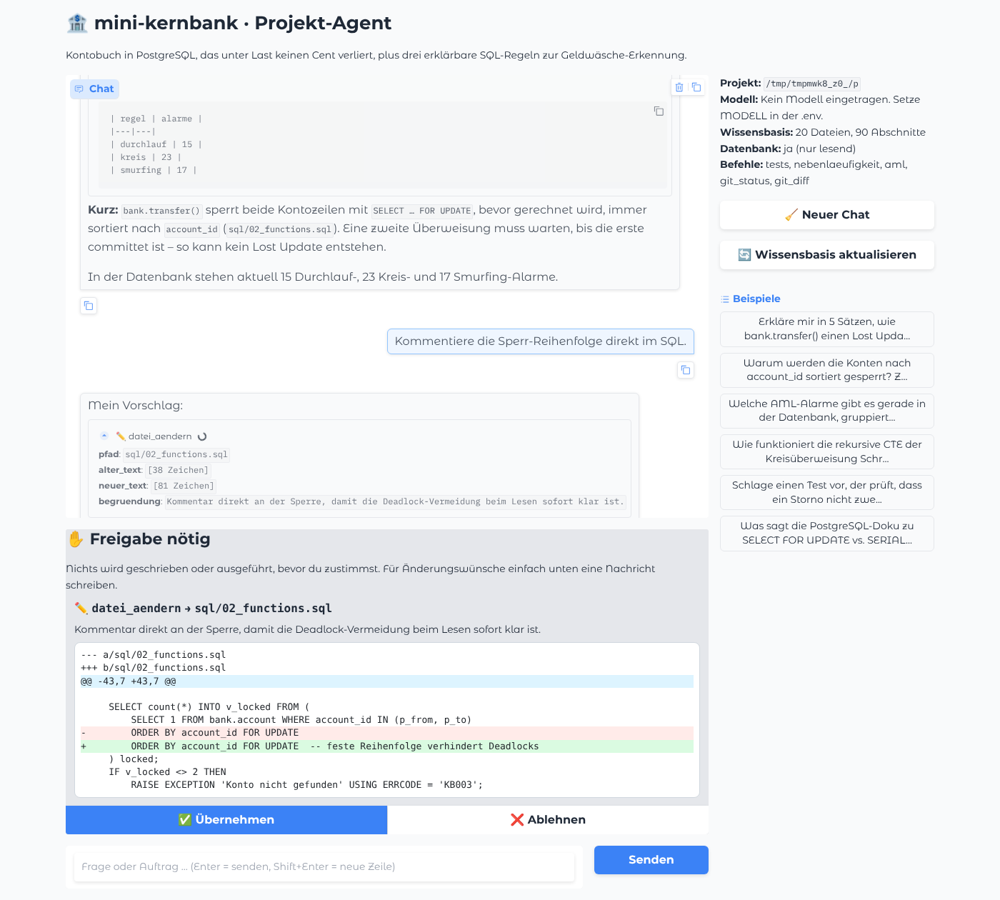

# 🏦 Projekt-Agent für mini-kernbank

Ein KI-Assistent, der **dieses Repository kennt**. Er beantwortet Fragen zum Code mit Belegstellen
(`datei:zeile`), fragt die Projektdatenbank **nur lesend** ab, recherchiert bei Bedarf selbstständig im Web
und **schlägt Änderungen nur vor**. Geschrieben oder ausgeführt wird erst, wenn du im Browser auf
„Übernehmen“ klickst.



<sub>Screenshot aus dem automatisierten Oberflächentest: Die Werkzeugergebnisse (Suche, SQL, Diff) sind echt,
die Antworttexte des Modells sind im Test vorgegeben, siehe [Tests](#tests).</sub>

## Schnellstart

Voraussetzungen: Python ≥ 3.10, Docker (für die Datenbank), ein API-Schlüssel **oder** Ollama.

```bash
bash agent/einrichten.command   # einmalig: Pakete, agent/.env, Wissensbasis (lädt ~2,3 GB Embedding-Modell)
bash agent/start.command        # startet Datenbank + Agent → http://localhost:7861
```

Unter macOS gehen beide Skripte auch per Doppelklick. In `agent/.env` wählst du das Sprachmodell:

| `LLM_ANBIETER` | Kosten | Code + Werkzeuge | Hinweis |
|---|---|---|---|
| `nvidia` (Standard) | kostenlos ([build.nvidia.com](https://build.nvidia.com)) | gut | ~40 Anfragen/Minute, Ersatzmodelle springen bei Ausfall ein |
| `anthropic` | pro Nutzung | sehr gut | die zuverlässigste Wahl für Code-Änderungen |
| `ollama` | kostenlos, offline | je nach Modell | braucht ein Modell mit Tool-Calling; Kontextfenster über `OLLAMA_NUM_CTX` (Standard 16384) |

## Was er kann

| Werkzeug | Zweck | Freigabe nötig? |
|---|---|---|
| `projekt_durchsuchen` | Hybride Suche über Code und Doku | nein |
| `datei_lesen`, `dateien_auflisten`, `text_suchen` | Code genau lesen, Struktur, grep | nein |
| `datenbank_abfragen` | SQL auf der laufenden Datenbank, **technisch nur lesend** | nein |
| `web_suchen`, `webseite_lesen` | Recherche, wenn das Projekt die Antwort nicht enthält | nein |
| `datei_aendern`, `datei_erstellen` | Änderungen vorschlagen, du siehst vorher den Diff | **ja** |
| `befehl_ausfuehren` | nur freigegebene Befehle: `tests`, `nebenlaeufigkeit`, `aml`, `git_status`, `git_diff` | **ja** |

**Beispielfragen**

- Erkläre mir in 5 Sätzen, wie bank.transfer() einen Lost Update verhindert.
- Warum werden die Konten nach account_id sortiert gesperrt? Zeig mir die Stelle.
- Welche AML-Alarme gibt es gerade in der Datenbank, gruppiert nach Regel?
- Wie funktioniert die rekursive CTE der Kreisüberweisung Schritt für Schritt?
- Schlage einen Test vor, der prüft, dass ein Storno nicht zweimal möglich ist.
- Was sagt die PostgreSQL-Doku zu SELECT FOR UPDATE vs. SERIALIZABLE?

## Wie es funktioniert

```
            ┌─────────── nur lesende Werkzeuge ───────────┐
            │                                              ▼
START → agent ── Werkzeug-Aufrufe? ─────────────────→ werkzeuge ──→ agent  (Schleife, max. 60 Schritte)
            │                                              ▲
            ├── Änderung / Befehl → freigabe ⏸ ────────────┘   ← wartet auf deinen Klick
            └── keine Aufrufe → Antwort
```

| Baustein | Umsetzung | Warum |
|---|---|---|
| Steuerung | [LangGraph](https://langchain-ai.github.io/langgraph/) mit `interrupt()` und SQLite-Checkpointer | echte Pause vor jeder Änderung; jeder Chat hat ein eigenes Gedächtnis |
| Zerlegen | code-bewusst: Python an Funktionen, SQL an Anweisungen, Markdown an Überschriften; Abschnitte immer auf ganze Zeilen ausgerichtet | Zitate wie `sql/…:42` stimmen exakt, Einrückung bleibt erhalten |
| Suche | **Hybrid**: Chroma + `BAAI/bge-m3` (lokal) **und** BM25, verschmolzen per Reciprocal Rank Fusion, plus Bonus für wörtliche Treffer | Vektoren verstehen Bedeutung, BM25 findet exakte Bezeichner |
| Aktualität | inkrementeller Index (SHA-1 je Datei) | beim Start werden nur geänderte Dateien neu eingelesen |
| Web | DuckDuckGo (`ddgs`) + `trafilatura` | kostenlos, ohne Schlüssel |
| Oberfläche | [Gradio](https://www.gradio.app/) | jeder Werkzeugschritt aufklappbar, farbiger Diff, Freigabe-Knöpfe |

### Sicherheit

1. **Freigabe:** Schreibende Werkzeuge laufen erst nach „Übernehmen“. Alle Vorschläge eines Schritts werden *gemeinsam*
   abgefragt, bevor irgendetwas passiert, deshalb wird bei der Wiederaufnahme nichts doppelt ausgeführt.
   Wer statt zu klicken eine Nachricht schreibt, lehnt ab, und die Nachricht geht als Begründung an den Agenten.
2. **Sandbox:** Lesen und Schreiben ist nur innerhalb des Repos möglich. Gesperrt sind `.git`, `.env*` und `.venv`.
   Pfade mit `..`, absolute Pfade nach außen und Symlinks nach außen werden abgewiesen.
3. **Datenbank:** Jede Abfrage läuft in einer `READ ONLY`-Transaktion mit 20-Sekunden-Limit. Auch ein in einer CTE
   verstecktes `UPDATE` scheitert an PostgreSQL selbst. Systemfunktionen, die Server-Dateien lesen oder Verbindungen
   beenden (`pg_read_file`, `pg_terminate_backend` …), sind zusätzlich gesperrt.
4. **Freigabe gilt nur für den gesehenen Stand:** Ändert sich die Datei zwischen Vorschau und Klick, wird nichts
   geschrieben. Wird eine Datei beim Ersetzen stark gekürzt, warnt die Vorschau ausdrücklich.
5. **Kein Selbstumbau, kein Heimnetz:** Der Agent darf `agent/` lesen, aber nicht ändern. `webseite_lesen` ruft nur
   öffentliche Adressen auf, nicht `localhost` und nicht das Heimnetz.
6. **Prompt-Injection:** Inhalte aus dem Web werden als Daten gerahmt, und Zeilen, die wie eingeschleuste Befehle aussehen, werden entfernt.
   Die eigentliche Garantie bleibt aber die Freigabe.

## Dieses Projekt individuell

Alles Projektspezifische steht in [`profil.yaml`](profil.yaml):

- **`wissen`**: Fachregeln, die der Agent immer im Kopf hat
- **`datenbank`**: Verbindung und eine Prüfabfrage für die Tests
- **`befehle`**: was er (nach Freigabe) ausführen darf
- **`beispiele`, `farbe`, `emoji`, `port`**: Startfragen und Aussehen

Die Wissensbasis und das Chat-Gedächtnis liegen in `agent/daten/`. Der Ordner ist nicht in Git, und `python app.py --neu` setzt ihn zurück.

**Port-Konflikt mit einem anderen Projekt:** Ist Port 5432 belegt, startet `start.command` die Datenbank auf 5433
(`docker-port-5433.yml`) und gibt dem Agenten die passende Adresse über `AGENT_DB_DSN`. Die `docker-compose.yml` des Projekts bleibt unverändert.

## Tests

```bash
cd agent && .venv/bin/python -m pytest -q
```

90 Tests, **ohne Sprachmodell und ohne API-Schlüssel**: Ein Skript-Modell spielt festgelegte Antworten samt
Werkzeugaufrufen ab, die Embeddings sind deterministische Attrappen. Schreibende Tests arbeiten auf einer Kopie des Repos.
Die Datenbank-Tests laufen gegen die echte Projektdatenbank und werden übersprungen, wenn sie nicht läuft.

| Datei | Prüft |
|---|---|
| `test_index.py` | Zeilennummern jedes Abschnitts exakt, eindeutige Bezeichner landen auf Platz 1, inkrementelles Aktualisieren |
| `test_werkzeuge.py` | jedes Werkzeug, Sandbox (7 Ausbruchsversuche + Symlink), SQL nur lesend, Web-Filter gegen Injection |
| `test_graph.py` | keine Änderung ohne Freigabe, genau einmal mit Freigabe, Ablehnung mit Kommentar, Fehler ohne Absturz, getrennte Chats |
| `test_app.py` | Oberfläche: kompletter Durchlauf inklusive Freigabe-Knopf |
| `test_profil.py` | im Profil genannte Dateien existieren, Befehle gültig |
| `test_robustheit.py` | Kontextfenster lokaler Modelle, Eigenheiten kleiner Modelle (Werkzeugaufruf als Text, `<think>`, falsche Argumente), Datei zwischen Vorschau und Freigabe geändert, Selbständerung, lokale URLs, SQL-Sonderfälle |

**Echttest mit dem echten Modell:** `.venv/bin/python echttest.py` stellt die Fragen aus `echttest` in `profil.yaml`
und prüft, ob das Modell die passenden Werkzeuge benutzt, Belegstellen nennt und Änderungen korrekt vorschlägt.
Freigaben gibt der Test automatisch, aber nur auf einer Kopie des Projekts. Der Bericht landet in `docs/echttest-<modell>.md`.
Berichte mit qwen3:14b: [Lauf 1](docs/echttest-qwen3-14b-lauf1.md) (2 von 5) · [Lauf 2](docs/echttest-qwen3-14b.md) (3 von 5, nach den Korrekturen) · Auswertung in ENTWICKLUNG.md, Abschnitt 6.

Wie der Agent entstanden ist, welche Entscheidungen getroffen wurden und welche Fehler die Tests gefunden haben,
steht in **[ENTWICKLUNG.md](ENTWICKLUNG.md)**.

## Grenzen

- Kostenlose Modelle rufen Werkzeuge manchmal mit falschen Parametern auf. Der Agent bekommt die Fehlermeldung zurück und korrigiert sich meist.
  Für Code-Änderungen ist Claude spürbar zuverlässiger.
- Die Websuche hängt von DuckDuckGo ab und kann zeitweise gedrosselt sein.
- Dateien über 300 KB und die Berichte als CSV werden nicht indexiert. Zahlen holt der Agent per SQL.
- Die Tests prüfen die Mechanik, nicht die Antwortqualität eines bestimmten Modells.

## Aufbau

```
agent/
├── app.py               # Gradio-Oberfläche + Start
├── profil.yaml          # alles Projektspezifische
├── kern/
│   ├── graph.py         # LangGraph: agent → freigabe → werkzeuge
│   ├── werkzeuge.py     # die 10 Werkzeuge + Diff-Vorschau
│   ├── index.py         # Zerlegen, Chroma + BM25, inkrementell
│   ├── guard.py         # Sandbox + Schutz gegen Prompt-Injection
│   ├── config.py        # Modell-Anbieter, Ausfallkette, Embeddings
│   └── profil.py        # lädt profil.yaml
├── tests/               # 90 pytest-Tests (ohne Sprachmodell)
├── echttest.py          # Test mit dem echten Modell → docs/echttest-*.md
├── einrichten.command   # Installation
└── start.command        # Datenbank + Agent starten
```
